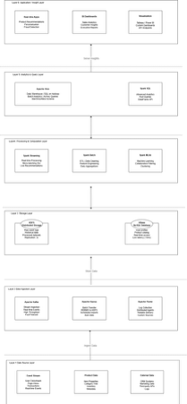
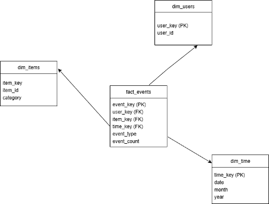
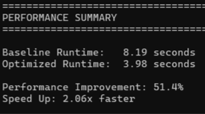

# E-Commerce Big Data Pipeline (Hadoop + Spark + Hive + HBase)

## Overview
This project implements an end-to-end big data pipeline for analyzing large-scale e-commerce user behavior data. It combines batch and real-time processing using a hybrid architecture.

The system processes raw clickstream data, transforms it using distributed computing, and enables both analytical insights and low-latency querying.

---

## System Architecture

The architecture integrates:
- **HDFS** for scalable distributed storage  
- **Apache Spark** for ETL and data processing  
- **Hive** for batch analytics and reporting  
- **HBase** for real-time data access  

---

## Data Model

The warehouse follows a **star schema**:
- Fact table: `sales_fact`
- Dimension tables: `dim_users`, `dim_items`, `dim_time`

This design improves query performance and simplifies analytical queries.

---

## Data Pipeline

1. **Data Ingestion**
   - Raw CSV files ingested into HDFS

2. **Data Processing (Spark)**
   - Data cleaning (null removal, deduplication)
   - Timestamp transformation → `event_date`
   - Feature preparation

3. **Data Storage**
   - Processed data stored in Hive (Parquet format)
   - Subset loaded into HBase for real-time access

---

## Analytics

The project supports multiple analytical use cases:

- **Top-N Product Analysis** (most viewed items)
- **User Activity Analysis** (most active users)
- **Event Distribution Analysis**
- **Behavioral Segmentation**

All queries are implemented using Hive / Spark SQL.

---

## Performance Optimization

Optimizations applied:
- Partitioning by `event_date`
- Bucketing by `visitorid`
- Parquet columnar storage
- Spark caching & repartitioning

### Results
- Baseline Query Runtime: **8.19 seconds**
- Optimized Query Runtime: **3.98 seconds**
- Performance Improvement: **~51.4% faster**

---

## Repository Structure

- `src/` → PySpark ETL pipeline and performance scripts  
- `sql/` → Hive / Spark SQL analytical queries  
- `hbase/` → HBase schema and optimization scripts  
- `assets/` → Architecture diagrams and performance results  
- `README.md` → Project documentation  

---

## Tech Stack

- Apache Spark (PySpark)
- Hadoop (HDFS)
- Hive
- HBase
- Python

---

## Key Takeaways

- Designed a **hybrid big data architecture** supporting both batch and real-time workloads  
- Built a **distributed ETL pipeline** for large-scale data processing  
- Implemented **data modeling (star schema)** for efficient analytics  
- Applied **performance optimizations** achieving over 50% runtime improvement  

---

## Notes

- This repository focuses on implementation and system design